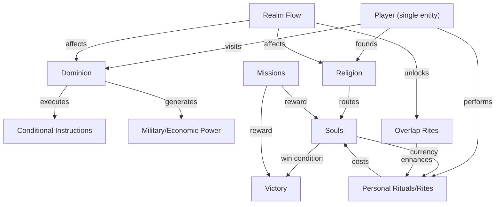

# Game Design Evaluation — v2

> Post-update assessment of the design after incorporating all latest decisions.

---

## 1. Overall Assessment

The design has matured significantly. Where the first evaluation identified 12 disconnected systems, the updated GDD now has **a coherent architecture** where most systems serve a clear purpose and connect to each other logically:

The player sits at the centre of a **spend-vs-hoard loop** (souls), a **breadth-vs-depth loop** (dominions), a **short-term-vs-long-term loop** (dominions vs religions), and a **personal-vs-institutional loop** (rituals vs instructions). Four distinct tensions, all mechanically clean. This is strong.

---

## 2. What Improved Most

### The Dominion/Religion Split
This is now the cleanest design decision in the game. Having two parallel systems with different time horizons, risk profiles, and strategic roles gives players meaningfully different tools:

| | Dominion | Religion |
|---|---|---|
| **Investment** | High (needs visits) | Low (set up and leave) |
| **Payoff speed** | Immediate control | Slow soul routing |
| **Risk** | Vulnerable to subversion | Vulnerable to rival religions |
| **Scalability** | Limited by visit frequency | Can spread passively |
| **Counter** | Player must visit to maintain | Player must establish counter-religion |

The insight that **religion can spread into territory you don't control** is particularly powerful. It means a player who is losing the dominion game can still compete in the religion game — and vice versa. This is a natural catch-up mechanic that doesn't feel artificial.

### Souls as Currency
Making souls both the win condition AND a spendable resource is the most important design decision so far. It creates the core tension that every good strategy game needs — a reason NOT to simply accumulate. Every soul spent on a rite is a soul not counted at the Convergence. Players who spend aggressively take risks; players who hoard play conservatively. Neither is obviously correct, which is exactly what you want.

### The N-Body Realm Model
This is inspired. N-body simulations have exactly the properties you want: predictable short-term, chaotic long-term, visually beautiful, and naturally escalating (bodies eventually collide). The trajectory-with-widening-uncertainty visualisation is elegant and solves the legibility problem from the first evaluation.

### Personal Agency
The addition of personal rituals, direct confrontation, and selfish motives addresses the biggest concern from the first evaluation (the "operations manager" problem). Players now have at least three personal verbs: perform rites, confront rivals, and pursue personal missions. Combined with the instruction system, this gives each turn a mix of strategic planning (instructions) and tactical immediacy (personal actions).

---

## 3. Remaining Risks

### 🔴 The Turn Is Overloaded

Look at everything a player might do on a single turn:
1. Review all dominion and religion status across all realms
2. Review realm flow predictions
3. Read any incoming scout reports
4. Set/update conditional instructions at their current dominion
5. Set scouting orders
6. Perform personal rites
7. Use relics
8. Interact with co-located players (confrontation/negotiation)
9. Choose next destination

That's **9 potential activities** per turn. In a simultaneous-turn game, all 4 players do this at the same time. If each turn takes 10-15 minutes of decision-making, a round could take an hour with downtime.

**Suggestion:** Impose an **action budget** — maybe 2-3 actions per turn. Setting instructions is one action. Performing a rite is one action. Using a relic is one action. Scouting is one action. This forces prioritisation (do you update instructions OR perform a rite?) and keeps turns tight. Choosing your destination is free (it's part of the turn resolution, not an action).

### 🟡 The Instruction System Needs Prototyping Early

Tiered complexity is the right call, but the UX will make or break this:
- The flowchart builder needs to feel like **dragging blocks on a whiteboard**, not like programming
- Map-click-to-flowchart is a killer feature if it works — click a node to set it as "expand toward here," click an army to set it as "if this army appears, defend" — but it needs to be tested very early
- Code mode is a nice power-user feature but should be hidden behind an "advanced" toggle, not visible by default

> [!IMPORTANT]
> **Prototype the instruction system BEFORE anything else.** It's the mechanic players will spend the most time interacting with. If it doesn't feel good, nothing else matters. Build a minimal flowchart builder with 3 conditions and 5 actions, test it with someone, iterate.

### 🟡 Religion Is Mechanically Thin

You've correctly identified religion as a core system. But right now its mechanical description is still just "belief tags that route souls." There are open questions about spread speed, organic evolution, player interaction, and structure. Until these are answered, you can't evaluate whether the dominion/religion split actually creates the strategic tension you want.

**A concrete suggestion for religion mechanics:**
- Founding a religion requires the player to be at a location for one turn (an action)
- The player chooses 2 belief tags from a pool of ~10 available tags
- The religion spreads to adjacent nodes at a rate of ~1 node per 2-3 turns (slow)
- Spread is faster if the belief tags align with the local realm's energy
- Spread is slower (or blocked) if a competing religion with contradictory tags is already established
- A player can have **multiple religions** (since they're lies anyway) — different religions in different areas, each optimised for local conditions
- Religions DON'T need active management once founded (unlike dominions) — this is their key advantage

### 🟡 Combat Is Completely Undefined

There WILL be military conflict — dominions have armies, there are weighted movement routes, expansion requires taking nodes. But there's no combat system at all yet. This matters because combat resolution affects:
- Whether the game is deterministic (pure strategy) or probabilistic (some luck)
- How much realm energy matters in military conflict
- Whether items/relics affect combat
- How long combat takes to resolve (affects pacing)

**Suggestion:** Keep combat simple. This is not a wargame — it's a manipulation/strategy game. Combat should be a means to an end, not the main event. A simple strength-comparison with modifiers (realm energy, relics, terrain) and minimal randomness would fit the tone. Maybe a deterministic combat system where the larger force wins but takes losses proportional to the defender's strength — no dice, no luck, just positioning and planning.

### 🟡 The Catch-Up Problem May Not Actually Exist

You wanted an explicit catch-up mechanic, but consider: the game already has several natural catch-up properties:
- Overexpansion punishes itself (too many dominions = neglect)
- Religion works independently of territory (a player losing dominions can still route souls)
- Souls-as-currency means the leader is incentivised to spend (reducing their lead)
- The Convergence scrambles everything (late-game chaos benefits underdogs)

Before designing an artificial catch-up mechanic, playtest the natural systems. You may find they're sufficient. Adding more catch-up on top could make the game feel like it punishes success.

---

## 4. The Biggest Open Design Space: Personal Progression

The GDD says players should have "a personal progression system — gaining something individually from their manipulations." This is flagged as open, and it's important.

The risk of NOT having personal progression: the player feels like a stateless cursor that teleports between dominions. Nothing changes about the player themselves — only their empire changes. This can feel hollow in a long game.

**Three possible approaches:**

**A — Power Accumulation:** Each soul collected (even spent ones) permanently increases the player's personal power level. Higher power makes rites stronger, confrontations easier, and subversion harder. Simple, clear, but might create a runaway leader problem.

**B — Forbidden Knowledge:** As the player explores realms, performs rites, and collects relics, they accumulate "knowledge" — understanding of specific realm energies. Knowledge unlocks more powerful rites and better condition options in the instruction system. This ties exploration to capability growth.

**C — Concept Evolution:** The player starts as a generic entity and gradually defines their identity through their actions. If they spend time in the Hunger realm, they gain Hunger-aligned powers. If they sacrifice many souls, they gain sacrifice-related abilities. The player BECOMES their playstyle. This is the most interesting option but the hardest to balance.

**Suggestion:** Option B (Forbidden Knowledge) as the primary system. It naturally encourages exploration (you want to visit different realms to learn their secrets), creates meaningful progression without snowballing (knowledge is useful but not overwhelming), and fits the Berserk/Souls aesthetic perfectly (both settings are full of forbidden, dangerous knowledge that transforms those who seek it).

---

## 5. Evaluation by System Maturity

| System | Maturity | Ready for Implementation? |
|--------|----------|--------------------------|
| Core loop (visit → instruct → leave) | ✅ High | Needs UX prototype |
| Realm flow (n-body model) | ✅ High | Needs physics parameters |
| Dominion/religion split | ✅ High (conceptual) | Religion mechanics need detail |
| Souls as currency | ✅ High | Needs economy balancing |
| Instruction system (tiered, flowchart) | 🟡 Medium | Needs UX prototype urgently |
| Dominion contestation | 🟡 Medium | Needs decay curve + subversion specifics |
| Rites & powers | 🟡 Medium | Blocked on realm energy definitions |
| Information/scouting | 🟡 Medium | Mechanics defined, needs balancing |
| Personal agency (rituals, confrontation) | 🔴 Low | Concept only, no mechanics |
| Combat | 🔴 Low | Completely undefined |
| Religion mechanics | 🔴 Low | Only belief tags defined |
| Missions | 🔴 Low | Structure undefined |
| Personal progression | 🔴 Low | Concept only |
| Lore | 🔴 Low | Options presented, not chosen |

---

## 6. Suggested Next Steps

1. **Choose a lore direction** — this will unblock realm design, energy systems, rites, and tone. See the lore suggestions document.
2. **Define religion mechanics** in detail — spread rules, founding costs, belief tag interactions.
3. **Define what a turn looks like end-to-end** — action budget, resolution order, timing.
4. **Prototype the instruction flowchart builder** — even a paper prototype or basic digital mockup would reveal UX problems immediately.
5. **Sketch the combat system** — keep it simple, but define it.
