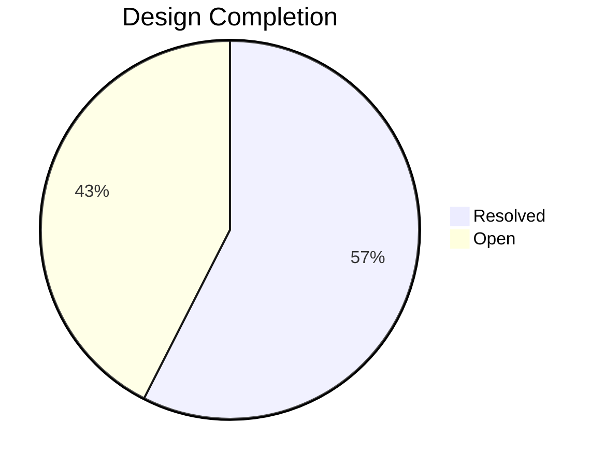

# Game Design Evaluation — v4 (Final Pre-Prototype)

---

## 1. Overall State

The design is **structurally complete**. Every major system exists, has a defined role, and connects to the others. What remains is detail-level mechanical definition — the kind of thing that benefits from prototyping rather than further theory.

**Resolved:** 23 decisions · **Open:** 17 questions

### What's Locked In
- Full lore (Covenant → Sundering → 5 realms → Ordained)
- Board topology (procedural graph, n-body flow, two interaction levels)
- Core loop (visit → instruct → act → move, 2 AP)
- Two parallel influence systems (dominions + religions) with distinct mechanics
- Soul economy (win condition + spendable currency)
- Additive realm merging with separate event/city layer
- Combat framework (deterministic + slight randomness + cards)
- Conditional instruction system (tiered, flowchart, map-click, code mode)
- Endgame (the Convergence + instant win via Rite of the New Covenant)

### What Holds Together Well

The **four tensions** that drive the game are all mechanically supported:

| Tension | Systems Involved | Status |
|---------|-----------------|--------|
| Hoard vs spend (souls) | Soul routing ↔ rite costs | ✅ Works |
| Breadth vs depth (dominions) | Core loop ↔ decay ↔ 2 AP | ✅ Works |
| Short-term vs long-term (dominion vs religion) | Immediate control ↔ slow soul routing | ✅ Works |
| Act vs prepare (personal vs instructions) | 2 AP budget ↔ instruction flowcharts | ✅ Works |

---

## 2. System-by-System Assessment

### ✅ Core Loop — Solid
The 2 AP budget with free destination is clean. Forces meaningful choices every turn. The "update instructions OR do something personal" trade-off is excellent. Only concern: does 2 AP feel like enough on turns where a lot is happening? Likely fine since personal actions are costly anyway — playtest will confirm.

### ✅ Realms & Flow — Solid
Five realms with distinct strategic profiles. N-body flow is elegant and thematic. Additive merge model is the right call — much simpler to reason about and implement.

### ✅ Lore — Complete
The Covenant/Sundering/Ordained framework is coherent, thematic, and mechanically aligned. Every game system has a lore justification. The Ordained's selfish motivation cleanly explains player behaviour.

### ✅ Soul Economy — Conceptually solid, needs numbers
The hoard-vs-spend tension is the game's heartbeat. Currently no numbers exist — how many souls does a religion generate? How much does a rite cost? These are balancing questions, not design questions. Answer during prototyping.

### 🟡 Religion — Mechanically defined, needs detail
The biggest system that still needs work. The architecture is right (belief tags, instructions, overexpansion risk, realm-specific behaviour) but the specific moving parts are undefined.

### 🟡 Combat — Framework exists, needs specifics
The shape is right (deterministic + randomness + cards). The specifics (strength calc, card list, randomness range) are balancing work for prototyping.

### 🟡 Dominions — Almost complete, needs establishing mechanics
How the player grabs a dominion in the first place isn't specified. Simple, but needs deciding.

### 🔴 Personal Progression — Concept only
The GDD says players should gain something from their manipulations. No mechanic exists yet.

### 🔴 Player Rituals — Concept only
The Ordained can perform personal rituals. What are they? What do they cost? What do they do?

### 🔴 Direct Confrontation — Concept only
When Ordained meet, confrontation is possible. Zero mechanics defined.

---

## 3. All Open Items — Prioritised with Suggestions

### Tier 1: Must Answer Before Prototype

These are the items where, if left undefined, a prototype cannot function.

---

#### 1. Belief Tags — What Are They?

Belief tags are the most load-bearing undefined mechanic. They determine soul routing, spread compatibility, follower combat behaviour, AND realm compatibility — all at once. They need to be defined.

**Suggestion:** 10 tags derived from the five forces, two per realm:

| Realm | Tag 1 | Tag 2 |
|-------|-------|-------|
| Dominion | **Obedience** — followers are loyal, hard to subvert | **Sacrifice** — followers give more (higher soul yield at death, but population declines faster) |
| Entropy | **Renewal** — religion regenerates after damage, hard to fully destroy | **Abandon** — followers care little about material possessions (spread is fast but followers don't fight well) |
| Communion | **Unity** — followers reinforce adjacent nodes (spread + mutual defence) | **Empathy** — followers resist aggression (strong defence, weak attack, harder to use in holy wars) |
| Wrath | **Fury** — followers fight harder (combat bonus, but more casualties) | **Defiance** — followers resist suppression (religion is very hard to attack/dismantle) |
| Memory | **Remembrance** — religion is persistent (very slow decay, nearly permanent) | **Wisdom** — followers generate information (scouting bonus from religiously controlled areas) |

A religion is founded with **2 tags** chosen from this pool. Tag combinations create different behaviour profiles. Tags from the same realm as the location spread faster. Tags from an opposing realm spread slower but provide unique advantages when they take root.

**Count:** Start with 2 tags per religion. Adjust up or down during balancing.

---

#### 2. Religion Instruction Options

Dominions have full conditional flowcharts. Religions need their own, simpler instruction set. What can you tell a religion to do?

**Suggestion — 6 base religion actions:**

| Action | Effect |
|--------|--------|
| **Spread toward [node/direction]** | Religion expands toward a target |
| **Hold** | Religion stops spreading, consolidates existing territory |
| **Slow spread / Fast spread** | Rate control — faster = higher collapse risk |
| **Resist suppression** | Followers prioritise survival over spread (defensive posture) |
| **Holy war** | Followers actively oppose a rival religion or dominion in their area |
| **Sacred festival** | Costs souls, temporarily boosts follower loyalty and spread |

These can be combined with conditions: "IF enemy religion enters our territory THEN resist suppression. IF population > threshold THEN spread toward [node]."

---

#### 3. Dominion Establishing Method

How does a player claim a new dominion?

**Suggestion:** The Ordained visits an uncontrolled settlement and spends **1 AP** to establish influence over its ruler. That's it — one action. The simplicity is intentional: the interesting part is not getting a dominion, it's keeping it and instructing it well. If the settlement is controlled by a rival, it's a contest (subversion), which is harder and may take multiple visits.

---

#### 4. Personal Rituals — What the Ordained Can DO

The Ordained need at least 2-3 personal actions that aren't "manage a dominion" or "manage a religion."

**Suggestion — 4 personal rituals (1 AP + soul cost each):**

| Ritual | Cost | Effect |
|--------|------|--------|
| **Rite of Sight** | Low (2-3 souls) | Reveal all instructions at your current location (enemy dominions, religions). Immediate intelligence. |
| **Rite of Binding** | Medium (5-8 souls) | Strengthen your control over a dominion or religion at your location — reset decay, reinforce against subversion, stabilise a risk-of-collapse religion. |
| **Rite of Severance** | Medium (5-8 souls) | Weaken a rival's control. Accelerate decay on an enemy dominion, disrupt an enemy religion's spread, or sever an edge on the graph (cutting a supply/travel route). |
| **Rite of Harvest** | High (0 cost, but destructive) | Sacrifice a population node to immediately collect all souls from it. The node is depopulated (can't generate souls again for many turns). Powerful but burns territory. |

These are the Ordained acting AS THEMSELVES — not through puppets. They cost souls (reinforcing the hoard-vs-spend tension) and have immediate, noticeable effects.

---

#### 5. Direct Confrontation Between Ordained

When two or more Ordained are at the same location, what happens?

**Suggestion:** Confrontation is **optional** and **asymmetric**. Either player can choose to confront. It's a battle of wills, not physical combat:

- Each Ordained commits a secret **soul bid** (any amount)
- Higher bid wins — the loser is **expelled** from the location (forced to a random adjacent node) and loses their bid. The winner keeps their bid but can't take other actions that turn (confrontation consumes both AP).
- If both choose not to confront, they coexist and take actions normally. This means confrontation is a power move that risks resources — you won't do it casually.
- Relics or specific rites might give advantages in confrontations (multipliers on bids, or preventing expulsion).

This is simple, fits the lore (souls are authority — spending them is asserting your will), and creates paranoia around co-location without making it purely punishing.

---

### Tier 2: Answer During Prototyping

These can be iterated on with a working prototype. Reasonable defaults are provided.

---

#### 6. Combat Card List
**Default suggestion:** Start with 5-6 cards, each earnable from rites or relics:
- **Ambush** — negate defender bonus
- **Fortify** — double defender bonus
- **Zealous Charge** — +30% attack, +50% own casualties
- **Feigned Retreat** — if you would lose, retreat with half casualties instead of full
- **Divine Intervention** — spend 5 souls to add +50% strength
- **Scorched Earth** — the node is depopulated regardless of who wins

---

#### 7. Specific Rites per Realm
Each realm should have 2-3 rites available at its rite sites:
- **Dominion rites:** Rite of Command (1 AP, 3 souls — give one extra instruction to any dominion without visiting it), Rite of Coronation (1 AP, 5 souls — instantly establish a dominion at your location even if contested)
- **Entropy rites:** Rite of Upheaval (1 AP, 4 souls — shuffle the ownership of all dominions within 2 nodes), Rite of Decay (1 AP, 3 souls — accelerate decay on all enemy dominions in this realm)
- **Communion rites:** Rite of Communion (1 AP, 3 souls — see all instructions at all nodes connected to your location), Rite of Schism (1 AP, 5 souls — split an enemy religion into two weaker ones)
- **Wrath rites:** Rite of the Forge (1 AP, 4 souls — permanently upgrade an army), Rite of Challenge (1 AP, 3 souls — force combat at a node even if the defender would prefer peace)
- **Memory rites:** Rite of Echo (1 AP, 5 souls — replay the instructions from one of your dominions from 3 turns ago), Rite of the Archive (1 AP, 3 souls — reveal one random mission held by a rival)

---

#### 8. Religion Collapse Mechanics
**Suggestion:** Each religion has a hidden **stability score** (0-100). Spreading increases it slowly. Spreading FAST decreases it. Being attacked decreases it. Below 20 → the religion is at risk of collapse. Each turn below 20, roll a percentage chance equal to (20 - stability). If triggered: the religion **fractures** — losing control of its outer nodes, belief tags may shift randomly, and soul routing is disrupted for several turns. The Ordained can stabilise by visiting and performing Rite of Binding.

---

#### 9. Merge Cities/Events
**Suggestion:** Design 2-3 merge events per pair (10 pairs = 20-30 events). These are stored in a lookup table. When a pair merges, draw 1-2 from that pair's pool. Examples:
- Dominion + Entropy → "The Crumbling Throne" (a temporary high-value node appears, whoever controls it gets bonus souls for 5 turns, then it collapses)
- Communion + Wrath → "The Crusade Begins" (all religions in the zone gain combat bonuses for 3 turns)
- Memory + Entropy → "The Fading Archive" (reveal all hidden information in the zone for one turn)

These can be added iteratively — start with 1 per pair and expand.

---

#### 10. Graph Generation Parameters
**Suggestion:** Each realm generates 8-12 nodes with 1.5-2.5 edges per node on average. 1-2 nodes are rite sites. 0-1 nodes hold a relic. Hub-and-spoke patterns for Dominion, dense interconnection for Communion, sparse/shifting for Entropy, clustered fortresses for Wrath, layered/deep for Memory. Use a realm-specific procedural template with randomised parameters.

---

#### 11. Soul Exchange Rate
**Suggestion:** Start with this baseline and adjust:
- A religion generates ~1-2 souls per turn per 3 nodes it covers (natural death rate)
- Basic rites cost 3-5 souls
- Powerful rites cost 5-10 souls
- Rite of the New Covenant (instant win) costs 50+ souls and requires specific conditions
- A full game might see 100-200 total souls flow through the economy
- Winning requires ~40-60 souls accumulated (not spent)

---

#### 12. Missions
**Suggestion:** Each player draws 3 hidden missions at game start, each worth 5-15 souls as bonus at the Convergence. Examples: "Control a dominion in 3 different realms simultaneously," "Have your religion be dominant in The Crucible," "Perform 3 different realm rites in one game," "Control a rite site in The Archive." Players can discard and redraw 1 mission at a cost (5 souls).

---

### Tier 3: Fine-Tune Through Playtesting

These don't need answers up front — good defaults exist and the right values will emerge from play.

---

#### 13. Scouting Detail & Detection
**Default:** Scouting reveals the top-level directive and army size. Not the full flowchart. Scouting is undetectable for now — add detection later if needed.

#### 14. Influence Decay Curve
**Default:** Linear, ~5% per turn. A dominion is firmly held for ~5 turns after a visit, vulnerable after ~10, autonomous after ~15-20.

#### 15. Game Length
**Default:** ~30-40 rounds. The n-body simulation is tuned so full convergence happens around round 35 ± 5 (chaotic variance).

#### 16. Catch-Up Mechanic
**Default:** Rely on natural catch-up (overexpansion punishes itself, religion works independently of territory). Add explicit catch-up only if playtesting shows runaway leaders.

#### 17. Personal Progression
**Default:** Deferred. The existing systems (rituals, relics, missions) provide enough variety. If playtesting shows players feel static, add a Forbidden Knowledge track (explore different realms to unlock stronger rites).

---

## 4. The Clearest Path to Prototype

If you were to answer the 5 Tier 1 questions, every system in the game would have enough mechanical definition to build a basic prototype. The Tier 2 and 3 items are tuning — they need a working system to tune against.

**Priority order for locking in Tier 1:**
1. Belief tags (unlocks religion system entirely)
2. Religion instructions (makes religion playable)
3. Dominion establishing (trivial but necessary)
4. Personal rituals (gives the Ordained their own verb space)
5. Direct confrontation (makes co-location interesting)

Once these are answered, the GDD can be marked as **prototype-ready** and design work shifts from "what should this system be?" to "does this system feel right?"
